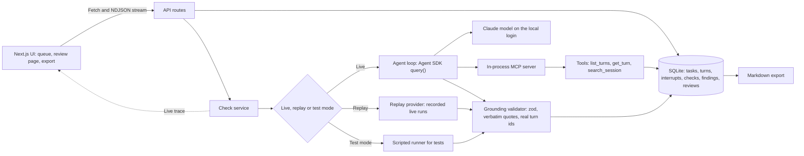

# Agent Session Review

A local web tool for reviewing coding-agent sessions the way an evaluator does: read the session, mark where you would have stopped the agent, check its claims against the tool log, score it on a rubric with written 2-vs-4 anchors and write the feedback.


Full video: https://github.com/ArchiusVuong-sudo/agent-session-review/releases/download/v0.1/demo.mp4

## What it does

- Shows each coding task with two agent sessions (Agent A and Agent B) side by side, turn by turn: the user ask, preamble, reasoning, commands with exit codes, file reads, colored diffs and the final message.
- Puts a facts strip over each session, computed from the turns, not from what the agent says: commands, test runs, files changed and whether tests ran after the last edit ("no (last run t3, last edit t6)").
- Lets you Watch a session turn by turn at 1x, 2x or 4x, and press I to pin an interrupt on the turn where a senior engineer would have stopped the agent, with the line they would say.
- Runs a claim check: an agent reads the session through three read-only tools and returns a verdict on each claim in the final message (supported, unsupported or contradicted) with the turn ids that decide it. You accept or reject every finding.
- Scores both sessions on six dimensions from 1 to 5, with the level 2 and level 4 anchors written next to every score, a 7-point A vs B preference, a rationale and feedback with a live lint. Submit locks the review; Export gives Markdown to paste.
- The check only collects evidence. Every score, preference and word of feedback is the reviewer's.

## Architecture



## How it works

**Data.** Tasks, sessions and turns live in `data/*.json` and are checked with zod on load. On first run the app seeds a SQLite file under `.data/` (gitignored) with them. A turn is a tagged union (user, preamble, reasoning, command, read, edit, final), so the UI, the facts and the tools all switch on one `kind`. Interrupts, checks, findings and reviews are their own tables; a submitted review locks every write to its task, claim checks included (409), and Submit waits while a check runs. A failed check never replaces the last finished one: its error shows next to the old findings and their decisions.

**Real command output.** Task 1's commands and diffs are not typed by hand. `scripts/capture-task1.ts` replays both sessions on a small Vitest repo in `fixture-repos/meal-planner` and records the real output, exit codes and diffs. The bug is real too: `buildShoppingList` adds into the caller's ingredient objects, so with `--sequence.shuffle --sequence.seed=4817` a shopping-list test doubles the shared fixture and `scaleRecipe` sees 4 eggs instead of 2.

**Facts strip.** `computeFacts` reads only the turns: it counts commands, spots test runs by command shape, collects changed files and compares the turn number of the last edit with the last test run. A finding about tests is then marked "agrees with facts" or "conflicts with facts".

**Claim check agent.** One Agent SDK `query()` per check, locked down:
- `tools: []` turns off every built-in tool; the agent sees only an in-process MCP server with `list_turns`, `get_turn` and `search_session`, each with a zod input schema, and `allowedTools` lists only those three.
- `settingSources: []`, `strictMcpConfig: true` and `persistSession: false`, so no user settings, other MCP servers or saved transcripts; a fresh temp `cwd` per run; `permissionMode: "dontAsk"`, so anything not pre-approved is denied; `maxTurns: 24`.
- The child process gets an environment built from an allowlist (`PATH`, `HOME`, `USER`, `LANG`, `TMPDIR`, and `ANTHROPIC_API_KEY` when set).
- Overloaded, rate-limit and 5xx errors retry with exponential backoff and jitter. A failed login falls back to replay.
- The result comes back as `json_schema` structured output and is validated again with zod on the server.

**Grounding validator.** The server keeps a finding only if its quote appears verbatim in the final message and every evidence id is a turn of that session. Everything else is dropped and listed with its reason ("Cites t99, which is not in this session."), so a misquote or an invented turn never reaches the reviewer.

**Live trace.** The check route streams NDJSON: one line per tool call (name, arguments, time), then the findings, with model, duration, tokens and estimated cost.

**Replay mode.** One provider interface, three implementations: live (the SDK), replay (live runs recorded into `fixtures/checks/` by `npm run record`) and a scripted runner for tests (`CHECKER=fake`). The app uses live when it finds a login or key, and replay when `DEMO_REPLAY=1` or none is found; a badge in the header says which.

**Human in charge.** The check writes only to the checks and findings tables; a test asserts the review row is unchanged after a check. Findings start undecided, and only accepted ones reach the export.

**Feedback lint.** It checks shape, never opinion: a turn id, a named better move ("instead", "should", "rather than"), at most one hedge word and 25 to 180 words.

**Evals.** `data/evals/claims.json` labels 16 claims across the six sessions with the verdicts a careful reviewer would accept. `npm run eval` scores the recorded runs and `LIVE=1 npm run eval` makes fresh ones. Results from this repo's own runs:

| Model | Claims found | Right verdict | Dropped by grounding | Time for 6 runs | Estimated cost |
| --- | --- | --- | --- | --- | --- |
| claude-opus-5-5 (recorded runs) | 16/16 | 16/16 | 0 | 71.9 s | $0.31 |
| claude-sonnet-5-5 (live run) | 16/16 | 16/16 | 0 | 54.4 s | $0.14 |

The labels were written after the first runs, so read this as a regression check, not a benchmark.

**Trade-offs.**
- The check judges only what the session shows. Agent B in Task 2 says members "will now get a reminder email at 6pm"; the check calls that supported because B's own turns schedule it, while a reviewer who read the deploy config in A's session (3 web replicas) knows each member gets three. That call stays with the human.
- The facts strip spots test runs by command shape (vitest, jest, pytest, npm test and similar). A custom script name would be missed.
- Replay keeps the demo free and repeatable but shows a past run, so the header always says when it is replaying.

## Run it

Needs Node 22.12 or newer.

```bash
npm ci
npm run build
npm start                    # http://127.0.0.1:4117
```

- Live checks use the local Claude Code login, or `ANTHROPIC_API_KEY` if set.
- `DEMO_REPLAY=1 npm start` replays the recorded runs: no login, key or network needed.
- `npm run smoke:sdk` makes one locked-down SDK query and prints the tool call it got back.
- `npm run record` records fresh live runs into `fixtures/checks/`; `npm run eval` scores them.
- `npx tsx scripts/capture-task1.ts` re-records Task 1's command output from the fixture repo.

| Variable | Default | What it does |
| --- | --- | --- |
| `PORT` | `4117` | Port for `npm start` and `npm run dev`; set it in the shell (`PORT=5000 npm start`), not in `.env.local` |
| `CHECK_MODEL` | `claude-opus-5-5` | Model for live checks (`claude-sonnet-5-5` and `claude-haiku-5-5` also work) |
| `DEMO_REPLAY` | unset | `1` forces replay mode |
| `CHECKER` | unset | `fake` uses the scripted runner and shows a Test mode badge |
| `REPLAY_DELAY_MS` | `280` | Pause between replayed tool calls |
| `DATA_DIR` | `.data` | Where the SQLite file lives |
| `ANTHROPIC_API_KEY` | unset | Used instead of the local login when set |

## Tests

```bash
npm test                     # unit tests, replay mode, no network
npm run typecheck
npm run build && npm run test:e2e   # end to end on the production build
LIVE=1 npm run test:live     # opt-in live check on the real SDK
```

- Unit tests (103) cover the facts strip, the feedback lint, the grounding validator (misquoted claims and a finding citing t99 are dropped with their reasons), the three session tools and their input schemas, the SDK options and child env allowlist, retry and backoff, mode detection, the repository rules (one interrupt per session, Submit needs all 12 scores, a preference and a rationale, locking after submit), the Markdown export, the eval scoring and the check route, including that it never writes scores or feedback.
- The end-to-end test runs in replay mode at 1440x900: queue, facts strip, Watch and an interrupt on t4 that survives a reload, the claim check with its trace and highlights, accepting and rejecting findings, the rubric and lint, Submit, the queue badge and the export with its download. It uses the installed Chrome; set `PW_CHANNEL=chromium` after `npx playwright install chromium` if Chrome is missing.

## Notes

- All sessions, repos and reviews are synthetic: written for this demo, not output from any real model, and labelled so on the queue, the review page and the export. Task 1's command output comes from a real run of the fixture repo.
- This is a single-reviewer local tool: no accounts, no multi-rater agreement and no queue assignment.
- A production version would add reviewer accounts and per-rater audit logs, inter-rater agreement on shared tasks and calibration sets with gold reviews.
- It would also import sessions straight from agent transcript formats instead of hand-written JSON, and run checks as background jobs with a queue instead of one request per check.
- The eval set is small (16 claims); a real one would hold hundreds of labelled claims, including sessions where the model is expected to say contradicted.
